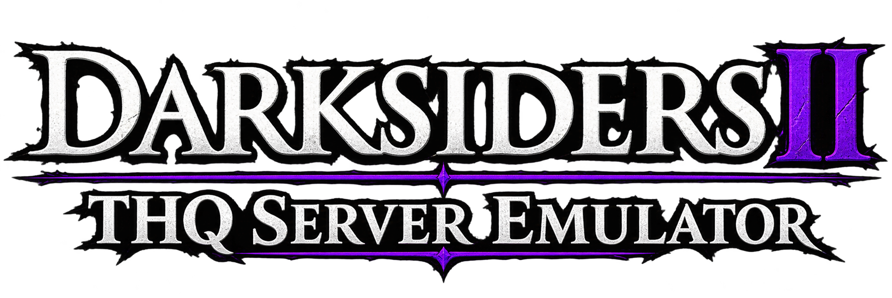

# Darksiders II — THQ Server Emulator

> **Mod information**  
> **Version:** 1.0 · **Game:** original Darksiders II on Steam (App ID 50650)  
> **Purpose:** local emulation of part of the discontinued THQ service used by the Serpent Tome.  
> **Development:** created with the assistance of GPT-6.1 Sol in Codex. An unofficial project, not affiliated with THQ Nordic, Vigil Games or Valve.

[Русский](README-RU.md)

## What it does

The mod lets you open the Serpent Tome's online tab and send a gift to a selected friend through the game's normal menu. A successful send can let the game unlock **Pay It Forward**, if you have not earned it yet. This has been verified in the original Steam release.

This is a local emulator, not a restoration of all THQ servers. Gifts are stored in a database on your computer. Delivery to a friend's computer and a shared online mailbox are not implemented.

## Getting started

1. Extract the entire archive into a separate writable folder. It can be located outside the game directory.
2. Start Steam and make sure the game is closed.
3. Open **DS2-THQ.exe**. The launcher detects the installed game automatically. If a file picker appears, select the original **Darksiders2.exe**.
4. Wait for the game to start and open the Serpent Tome. In the online inbox tab, choose to add a gift, then select an item and a friend.

Launch the game through **DS2-THQ.exe** whenever you want to use the emulator. Keep the EXE with its accompanying folders and do not run it inside the ZIP. A separate Python installation is not required.

## How it works

The launcher starts a local server at `127.0.0.1:18086` and gives the game proxy settings scoped to its process. The emulator handles requests to supported THQ addresses. It commits each gift to a local SQLite database before acknowledging the send.

To allow HTTPS connections, the launcher temporarily replaces trusted certificate data in the game process's memory at startup. **The game's EXE and DLL files on disk and its machine instructions remain unchanged. Data in RAM is changed**, and a new launch without the mod starts with the original data. The system certificate store and global proxy settings are not changed. The mod does not edit saves or call achievement-unlocking APIs.

## Archive layout

| File or folder | Purpose |
| --- | --- |
| **DS2-THQ.exe** | Main launcher for the mod and game |
| **bin** | Server, bundled Python and required components |
| **extras** | Optional tools and maintenance commands |
| **info** | Instructions in both languages, logo and component licenses |

Runtime files are created in `bin/data`: the mailbox database, certificates, logs and remembered game path. This folder may contain personal data; do not publish it. To move your local mailbox, close the game, stop the server and move the entire mod folder, including `bin/data`.

## Optional tools

All commands are in **extras**:

- **Choose-Game.cmd** — select the game EXE again.
- **Check-Mod.cmd** — check the game path and bundled components without launching the game.
- **Stop-Server.cmd** — stop this copy's server. Close the game normally first.
- **Start-Darksiders2-Offline.cmd** — start the game with fast failure for unavailable servers. The online Serpent Tome does not work in this mode.
- **Set-60FPS-NVIDIA.cmd** — set a 60 FPS limit in the separate Darksiders II NVIDIA profile.
- **Restore-FPS-NVIDIA.cmd** — restore settings from the backup previously created on this computer.

The FPS limit is optional and is never applied automatically. NVIDIA tools require a compatible NVIDIA driver.

## Compatibility and limitations

Supports the original Windows Steam release of Darksiders II, build **mainline538065**. **Deathinitive Edition is not supported.** The launcher checks the game SHA-256 and rejects other builds:

`39FED14186C343FDF7F7D87B6FA779247A715347084D9E14A2708A0D7BF951B9`

Only the necessary part of the service is implemented, not every THQ feature. Achievements require the game's normal Steam connection. Acceptance by SteamHunters or other achievement-tracking communities has not been confirmed; consult their moderators before using the mod for ranked hunting.

## Troubleshooting

- Make sure the entire archive is extracted, the folder is writable and the game is closed before opening the launcher.
- If the game has moved, use `extras/Choose-Game.cmd`.
- If another copy is using the server port, close the game and run `extras/Stop-Server.cmd` from the folder that started that server.
- Do not overwrite an older installation with this reorganized package. Extract it into a new folder. Old data is not migrated automatically.
- Use `extras/Check-Mod.cmd` and the logs in `bin/data` for diagnosis. Check logs for personal information before sharing them.

## Removal

Close the game and run `extras/Stop-Server.cmd`. If you applied the NVIDIA limit and want to undo it, run `extras/Restore-FPS-NVIDIA.cmd` first. You can then delete the mod folder. Deleting `bin/data` also deletes the local mailbox and settings backup.
